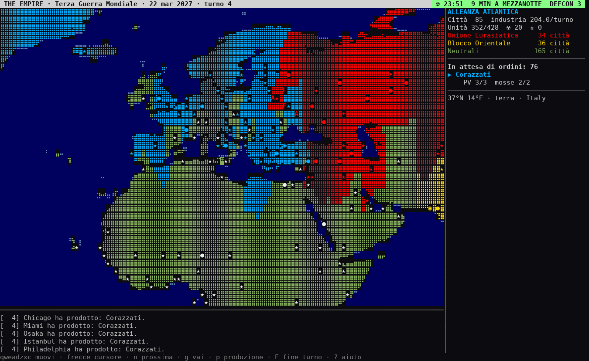

[English](README.md) · **Italiano**

# THE EMPIRE

Gioco di strategia globale a turni per il terminale. Prende la **guerra
totale** di *Theatre Europe* (1985: armate, attacchi aerei, armi chimiche,
escalation nucleare, l'apocalisse come sconfitta di tutti) e un classico
**sistema di conquista** a griglia (città che producono unità, trasporti,
portaerei, carburante degli aerei, nebbia di guerra) e li porta **sulla scala del mondo intero**.
Dai giochi da tavolo prende le **carte** (alla Futurisiko), gli **obiettivi
segreti** e i **bonus continentali** (alla Risiko) e gli **eventi mondiali**
che rimescolano i piani.

La mappa è il mondo reale: viene dai dati Natural Earth ed è disegnata in
caratteri Braille come in [Terrascope](https://github.com/a-shygun/Terrascope),
il punto di partenza del progetto. Ogni carattere è una casella di gioco
(1° di longitudine × 2° di latitudine) e i suoi 2×4 punti Braille
disegnano la costa vera. La mappa si avvolge da est a ovest: il Pacifico si
attraversa. Il Mediterraneo è navigabile per intero, dall'Atlantico al
Levante: il canale tra Tunisi e la Sicilia è stato aperto a mano (in
`assets/world.json`), dato che la griglia da 1°×2° non lo ricavava dalle
coste Natural Earth.



### In breve: come si vince

Ogni fazione ha un **obiettivo segreto** (per esempio «conquista Nord
Africa e Medio Oriente» o «elimina il Blocco Orientale»): chi lo completa
vince subito. Altrimenti vince chi **domina** il mondo (55% delle città),
chi elimina tutti i rivali o chi ha più punti allo scadere dei turni. Se
l'**Orologio dell'Apocalisse** arriva a mezzanotte, perdono tutti.

Per arrivarci:
- **conquisti città** con fanteria e corazzati: ogni città produce un'unità
  alla volta, e le **direttive** (`P`) riconvertono tutte le fabbriche;
- tieni **intere regioni** (13 nel mondo) per un bonus di produzione dal
  +10% al +30% in tutto l'impero;
- giochi le **carte** (`K`): spionaggio, diserzioni, rivolte, colpi di stato;
- sfrutti gli **eventi mondiali**, che ogni 5-8 turni cambiano le regole
  per tutti (crisi petrolifera, carestia, boom, vertice dell'ONU...);
- usi la **diplomazia** (`O`) per firmare tregue sul fronte secondario.

Il tasto `o` mostra tutto in una pagina: il tuo obiettivo e a che punto
sei, le regioni con chi le tiene, gli eventi in corso.

## Avvio

Se è la prima volta, comincia dal **tutorial**: è il primo scenario del menu
(oppure `python3 -m theempire --scenario tutorial`). Un istruttore, in un
riquadro sulla mappa, ti spiega una cosa alla volta e aspetta che tu la
faccia davvero: guardare la mappa, selezionare e muovere un'unità, dare un
ordine di marcia, scegliere la produzione e una direttiva, finire il turno
e leggere il bollettino, conquistare una città, giocare una carta. Poi ti
presenta l'obiettivo segreto e le regioni (aprendo la pagina `o`) e ti fa
vedere un evento mondiale vero, un boom economico da sfruttare. Alla fine
ti lascia l'obiettivo: prendere Tirana, con una carta Rinforzi in regalo.
`h` nasconde o mostra il riquadro.


Serve Python 3.10+ e un terminale UTF-8, meglio se a 256 colori. Il gioco
usa solo la libreria standard: niente da installare.

```bash
python3 -m theempire                 # menu: scenario, fazione, difficoltà
python3 -m theempire --list          # scenari e fazioni
python3 -m theempire --scenario ww3 --faction east --difficulty difficile
python3 -m theempire --scenario coldwar --faction nato --faction pact   # hot-seat, 2 giocatori
python3 -m theempire --load          # riprende ~/.theempire/save.json
python3 -m theempire --autoplay 100 --seed 1   # IA contro IA, senza interfaccia
python3 -m theempire --lang en       # gioco in inglese (it, en, fr, es, de, pt)
```

Per installarlo come comando: `pip install .` e poi `theempire`.

## Lingue

Il gioco è disponibile in **italiano, inglese, francese, spagnolo, tedesco e
portoghese**. La lingua si sceglie:
- da riga di comando con `--lang it|en|fr|es|de|pt`;
- dal primo menu («Lingua / Language»);
- in partita con il tasto `L`;
- nella schermata di configurazione del server (riga «Lingua»);
- nel modulo di accesso della web TUI.

Senza scelta esplicita il gioco usa la lingua salvata l'ultima volta, poi
quella del sistema (`LANG`), altrimenti l'italiano. Nelle partite online
ogni giocatore vede il gioco nella propria lingua: i messaggi del registro
di guerra li traduce ciascun client.

Le traduzioni stanno in `theempire/locales/<lingua>.json`, con il testo
italiano come chiave. `python3 tools/i18n.py check` elenca le traduzioni
mancanti o rotte, `python3 tools/i18n.py update` aggiunge ai cataloghi i
testi nuovi.

## Musica ed effetti sonori

Suoni e musiche sono **sintetizzati dal gioco stesso** in stile 8-bit, con
onde quadre, triangolari e rumore come i computer di Theatre Europe. Nel
progetto non c'è nessun file audio: al primo avvio vengono generati in un paio
di secondi in `~/.theempire/sounds`.

- **Musica**: nel menu e nella lobby la Toccata in re minore di Bach
  (omaggio a Theatre Europe; la composizione è di pubblico dominio), in
  guerra una marcia in minore con rullante, e quando l'Orologio scende sotto
  i 5 minuti un tema di tensione con battito cardiaco e ticchettio. A fine
  partita c'è una fanfara di vittoria, un lamento per la sconfitta o il vento
  sul mondo morto a mezzanotte. Con il tasto `M` puoi scegliere la musica:
  automatica, nessuna, **Kalinka** (il ritornello veloce e la strofa lenta
  «Ах, под сосною», ricavati dall'arrangiamento MIDI di riferimento), l'**inno sovietico** (il «Союз нерушимый» di Aleksandrov,
  trascritto dalla partitura ufficiale: strofa e ritornello completi), la
  Toccata, la marcia, la tensione, la vittoria, la sconfitta o la mezzanotte.
- **La tua musica**: metti dei file MIDI (`.mid`) nella cartella
  `~/.theempire/music` (o in quella indicata da `THEEMPIRE_MUSIC`) e
  compaiono nel menu `M` con il nome del file e i tasti 1-9: per esempio
  `~/.theempire/music/Give Peace a Chance.mid` diventa «Give Peace a
  Chance». Il gioco li suona con il suo sintetizzatore (basso, chitarre,
  melodia e batteria, al massimo 4 minuti) e li prepara una volta sola
  nella cache. I file restano tuoi: non fanno parte del gioco né del
  repository. Nella web TUI si usa la cartella di chi avvia il server.
- **Effetti**:
  - battaglie, città conquistate o perdute, crolli di una fazione;
  - attacco nucleare (sirena, fischio, esplosione), missile intercettato,
    gas, aereo abbattuto;
  - tregua, inizio del tuo turno online, allarmi.
- **Ogni unità ha la sua voce**: un suono quando si muove e
  uno quando apre il fuoco.

  | Unità | Movimento | Fuoco |
  |---|---|---|
  | Fanteria | passi di marcia | raffica di fucili |
  | Corazzati | motore diesel e cingoli | colpo del cannone |
  | Caccia | jet che passa | raffiche di cannoncino |
  | Bombardiere | motori pesanti che ronzano | fischio delle bombe ed esplosioni |
  | Cacciatorpediniere | fischio e eliche veloci | cannoni a tiro rapido |
  | Sottomarino | ping del sonar | siluro in corsa e impatto |
  | Trasporto | motore lento e sirena bassa | — |
  | Incrociatore | sirena profonda | bordata dei cannoni pesanti |
  | Portaerei | sirena e decollo degli aerei | stormo che decolla |

  Le battaglie che ti riguardano suonano con le armi di chi attacca: senti
  arrivare il siluro del sottomarino nemico.
- **Bollettino di guerra.** All'inizio di ogni tuo turno la telecamera
  ripercorre quello che gli altri hanno fatto dal tuo turno precedente,
  come nel Theatre Europe. Vale per le fazioni dell'IA e per gli altri
  giocatori, in hot-seat e online:
  - le armate in marcia, con la voce di ogni unità;
  - **ogni attacco in primo piano**: la mappa si centra sullo scontro, un
    anello lampeggia intorno al bersaglio, l'attaccante si illumina, poi
    fuoco ed esplosione con il suono della sua arma e infine l'esito
    (bersaglio distrutto, attaccante respinto, città caduta). Gli attacchi
    contro di te durano di più e sono segnalati come «ATTACCO CONTRO DI NOI»;
  - le città conquistate e perdute, le atomiche e le armi chimiche.

  Mentre scorre l'animazione, nel riquadro in basso si scrive la **cronaca**
  di ogni scena. Alla fine compare il **bollettino scritto**, diviso in
  sezioni:
  - armi di distruzione di massa;
  - il nostro fronte: ogni attacco subito, dove, con che unità e com'è finito;
  - le città che hanno cambiato bandiera (quelle perse sono evidenziate);
  - gli altri scontri avvistati;
  - i movimenti osservati: quante unità e di che tipo, di quali fazioni, e
    le zone più attive.

  ```
  IL NOSTRO FRONTE · 6 attacchi subiti, 2 respinti
  ⚔ CONTRO DI NOI · Bombardiere (Unione Eurasiatica) sulla città di Kharkiv → RESPINTO
  ⚔ CONTRO DI NOI · Corazzati (Unione Eurasiatica) sulla città di Kharkiv → LA CITTÀ CADE
  CITTÀ CHE HANNO CAMBIATO BANDIERA · ne perdiamo 1
  ⚑ Kharkiv conquistata da Unione Eurasiatica (prima: Alleanza Atlantica) — PERSA
  ```

  Un tasto qualunque salta l'animazione. `B` apre in ogni momento
  l'**archivio dei bollettini** (gli ultimi 30 turni): ↑↓ scorre, ←→ passa
  ai turni precedenti e successivi, `R` rivede l'animazione di quel turno.
  Il bollettino rispetta la nebbia di guerra (online la applica il server),
  sfoltisce le marce troppo lunghe e non consuma il tempo del turno.
- Senti solo gli eventi che conosci. Le battaglie lontane tra altri e le
  esplosioni nella nebbia di guerra restano mute. Le atomiche si sentono in
  tutto il mondo.
- Il tasto `M` apre il menu audio: scegli la musica (automatica, nessuna,
  Kalinka, inno sovietico, Toccata di Bach, marcia di guerra,
  tensione, vittoria, sconfitta, mezzanotte) e attiva o disattiva gli
  effetti. La scelta resta per le partite successive. Da riga di comando:
  `--audio all|sfx|off` oppure `--muto`.
- Per suonare usa il lettore già presente: `afplay` su macOS, `paplay`,
  `pw-play` o `aplay` su Linux, altrimenti `ffplay`. Se non ne trova nessuno
  il gioco funziona lo stesso e usa il beep del terminale per gli eventi
  importanti. Il server online non suona: l'audio è sul computer di ogni
  giocatore.

## Giocare dal browser

Il gioco si può giocare anche da un browser. La pagina si apre sulla
**mappa grafica** (vedi sotto); la **web TUI**, su `/tui`, è il terminale
stesso nel browser: stessa mappa Braille, stessi colori, tasti e mouse, e
l'audio suona nel browser.

```bash
# server di gioco su 7777 + pagina web su 8080
python3 -m theempire --serve --web --scenario ww3 --faction west --faction east --password segreta
# poi i giocatori aprono http://<indirizzo-del-server>:8080/  (la mappa; /tui per il terminale)
```

- La web TUI chiede nome, fazione e password. Il server avvia per ogni browser
  un client vero in un terminale virtuale e lo mostra con
  [xterm.js](https://xtermjs.org/) (MIT, incluso nel progetto: non serve
  internet).
- **Tablet e telefoni**: il tasto ⌨ mostra una pulsantiera con le direzioni,
  le frecce del cursore e i comandi principali (Invio, prossima, vai a,
  produzione, fine turno...). Con A− / A+ cambi la dimensione del testo.
- **Audio nel browser**: effetti e musiche viaggiano come segnali invisibili
  nel flusso del terminale, e la pagina li suona con la Web Audio API. Il
  pulsante 🔊 li spegne.
- **Rientro**: il browser ricorda il tuo posto. Se ricarichi la pagina torni
  alla tua fazione.
- Si può mettere la pagina web davanti a un server di gioco altrui:
  `python3 -m theempire --join host:7777 --web 8080`.
- La password non passa mai nell'indirizzo: viaggia dentro la connessione.
  Su internet mettete comunque la pagina dietro HTTPS (un reverse proxy come
  Caddy o nginx) o una VPN. Funziona su Linux e macOS, perché usa i terminali
  virtuali del sistema.

### La mappa grafica
La pagina web si apre su una vera mappa, disegnata nel browser:
`http://<indirizzo-del-server>:8080/` chiede nome, fazione e password, poi
si gioca sulla mappa. Il terminale c'è ancora, su
`http://<indirizzo-del-server>:8080/tui` («⌨ TUI» in alto sulla mappa; 🗺
nella web TUI torna indietro): i due condividono il posto del browser.

- **Cosa mostra**: la costa dalla mappa fine della terra, il territorio di
  ogni città nel colore di chi la possiede, la nebbia di guerra, il teatro di
  guerra, le zone contaminate, le città con i nomi e le unità come **pedine
  da wargame** (il numero sull'angolo è la pila). Sugli esagoni la plancia ha
  esagoni regolari, come un wargame stampato; il pulsante ⬡ passa alle
  proporzioni vere della geografia (predefinite sui quadrati).
- **Mani e mouse**: trascinate per spostarvi, rotella o pizzico per lo zoom,
  un tocco su una casella mostra cosa c'è (luogo, città, padrone, le vostre
  unità). Il mondo si richiude da est a ovest, come nel gioco. Il pannello
  laterale elenca fazioni, casella ed eventi recenti; ☰ lo nasconde, `Aa`
  i nomi delle città, ⌂ riporta alla vostra zona.
- **Ordini sulla mappa**: toccate una vostra unità per selezionarla
  (lampeggia in giallo; un altro tocco passa alla successiva della pila);
  toccate una casella accanto per muovere o attaccare; toccate una casella
  lontana per vedere il percorso (tratteggiato) e toccatela di nuovo per
  partire. Il pannello ha Prossima, Salta, Sentinella, Fortifica e Sveglia,
  e in basso c'è FINE TURNO; in alto un'etichetta dice di chi è il turno.
  Con la tastiera: `q w e` `a d` `z x c` (o il tastierino) muovono,
  `n`/Tab prossima, spazio salta, `s` sentinella, `f` fortifica, `v`
  sveglia, `E` fine turno, Esc deseleziona.
- **Produzione**: toccate una vostra città (oppure selezionatela e premete
  `p`, o il pulsante «Produzione…» nel pannello) per scegliere cosa
  costruisce: tutte le unità e gli oggetti speciali che può fare, con costo,
  turni e forza, quello attuale evidenziato. Scegliere a mano toglie la
  città dalla direttiva; «Torna alla direttiva» ce la rimette. Un anello
  giallo attorno a ogni vostra città mostra a che punto è la produzione.
- **Direttiva**: il pulsante «Direttiva» sotto le fazioni (o `P`) dà un
  solo ordine a tutta l'economia di guerra, come nel terminale: manuale,
  bilanciata, offensiva terrestre, potenza aerea, dominio dei mari, sbarchi,
  difesa, deterrenza. Le città impostate a mano restano come sono, a meno
  di spuntare la casella per includerle.
- **Armi di distruzione di massa**: ☢ (o `N`) e ☣ (o `C`) in basso armano
  l'attacco; la casella sotto il puntatore e quelle accanto si accendono in
  rosso o in verde (ciò che l'esplosione colpirebbe), un tocco sceglie il
  bersaglio. Un lancio nucleare chiede, come nel terminale, di digitare il
  codice di autorizzazione mostrato nel riquadro; il gas deve cadere entro
  4 caselle dalle vostre forze. Poi il lampo, la palla di fuoco e lo
  schermo che trema. Il pannello mostra le scorte (☢ testate, ☣ armi
  chimiche, 🛰 satelliti, ✦ armi antisatellite).
- **Spazio** (scenari con le armi di oggi): 🛰 (o `Z`) elenca i vostri
  satelliti spia e la fascia che ognuno sorveglia, e lancia le armi
  antisatellite contro i satelliti di un rivale. Le fasce sorvegliate sono
  strisce azzurre tenui sulla mappa.
- **Carte**: «♠ Carte (K)» sotto le fazioni mostra la mano, con le
  probabilità di ogni carta; Gioca la gioca. Le carte contro una fazione
  chiedono quale; quelle su una città o un'unità accendono in magenta la
  casella sotto il puntatore, e un tocco le gioca lì. Lo spionaggio apre il
  rapporto dei servizi segreti. La diplomazia (tregue) per ora resta nella
  TUI.
- **Battaglie e turno nemico animati**: i vostri attacchi si vedono sulla
  mappa (il fuoco dell'arma vola sul bersaglio, l'esplosione, poi ✕ su chi
  ha perso o ⚑ sulla città presa). Quando gli altri hanno mosso parte il
  **bollettino di guerra**, come nel terminale: la telecamera segue le loro
  armate, che scivolano di casella in casella, e si avvicina a ogni
  battaglia, conquista, attacco nucleare o chimico, con la riga della
  cronaca in un riquadro («⚔ CONTRO DI NOI...» in rosso quando colpiscono
  le vostre forze; lo schermo trema). Le unità nemiche compaiono solo
  quando il bollettino le porta. Un tocco, Esc o «Salta ▶▶» lo chiudono;
  poi la vista torna dov'era. 🔊 accende o spegne i suoni della mappa.
- **La stessa nebbia del gioco**: la mappa segue il posto che quel browser
  occupa (si collega al server come *osservatore* con il gettone di quel
  posto), quindi mostra solo ciò che vede la vostra fazione. Senza un posto
  chiede di entrare prima dalla pagina di gioco. TUI e mappa si usano
  insieme: ogni mossa compare subito anche sull'altra.
- **Anche da un terminale vero**: nelle partite online il cui server ha la
  pagina web (`--serve --web`), `W` mostra il link alla mappa del vostro
  posto, da aprire nel browser di qualunque dispositivo: cliccatelo (nei
  terminali che gestiscono i link, e nella web TUI) o premete `C` per
  copiarlo negli appunti. Il gettone del
  posto sta dopo il `#` (quella parte i browser non la mandano al server):
  il link vale quanto il vostro posto, non datelo agli avversari.
- Non le serve nulla da internet: niente tile, niente servizi esterni.

## Multiplayer online

Una partita online ha un **server** che tiene la partita e guida le fazioni
dell'IA, e fino a un **giocatore per fazione** che si collega da un altro
terminale o da un altro computer. Le fazioni indicate con `--faction` sono i
posti per i giocatori umani; le altre le gioca l'IA. Senza `--faction`, tutte
le fazioni sono posti umani.

### La schermata di configurazione
Il modo più semplice per ospitare: `python3 -m theempire --serve` (senza
scenario), oppure la voce **«Ospita una partita online...»** del menu
iniziale. Si apre una pagina con tutte le opzioni:

| Opzione | Cosa decide |
|---|---|
| Partita | nuova, o una salvata da un server precedente |
| Scenario | quale guerra |
| Una riga per fazione | giocatore umano (un posto) oppure IA |
| Difficoltà dell'IA | facile, normale, difficile |
| Obiettivi segreti, Eventi mondiali | sì o no |
| Tempo per turno | nessun limite, 60, 90, 120, 180 o 300 secondi |
| Tu giochi con | nessuna (solo server) o la fazione con cui giochi da questo terminale, e il tuo nome |
| Porta di gioco, Web TUI, Porta web | dove entrano i client e il browser |
| Password | vuota = partita aperta a tutti |

Si sceglie con ↑↓, si cambia con ←→ o spazio, nei campi di testo si scrive.
Un avviso spiega cosa non va (nessun posto umano, porte uguali...). In
fondo alla pagina c'è sempre il **comando equivalente**, da copiare per la
volta dopo. All'avvio il server stampa come entrare: il comando `--join`
con l'indirizzo della macchina nella rete locale e l'indirizzo per il browser.

### Da riga di comando

```bash
# chi ospita: server su porta 7777, posti per NATO e Patto, 3 minuti a turno
python3 -m theempire --serve --scenario coldwar --faction nato --faction pact \
        --password segreta --turn-time 180

# chi ospita e gioca dallo stesso terminale (server in background)
python3 -m theempire --serve --scenario ww3 --faction west --faction east --play west

# gli altri giocatori
python3 -m theempire --join 192.168.1.20 --name Bruno --password segreta
python3 -m theempire --join mioserver.example.org:7777 --faction east
```

- La partita comincia quando tutti i posti sono occupati. Fino ad allora
  compare la lobby con i nomi dei giocatori.
- I turni restano a fazioni alterne: mentre tocca agli altri puoi guardare
  la mappa, la panoramica e il registro, e scrivere in **chat** (`T`). Quando
  tocca a te il terminale emette un beep.
- **Nebbia di guerra vera.** Il server manda a ogni giocatore solo le unità
  nemiche che le sue forze vedono, e solo i suoi messaggi. Il generatore
  casuale dei combattimenti resta sul server. Il server controlla ogni
  comando, quindi non si può muovere un'unità altrui né agire fuori turno.
- Con `--turn-time` il server chiude da solo il turno di chi supera il
  tempo. Il conto alla rovescia compare in alto.
- `--senza-obiettivi` e `--senza-eventi` tolgono obiettivi segreti ed
  eventi mondiali (valgono anche nelle partite in locale).
- **Rientro.** Se cadi, rilancia lo stesso `--join`: il client ha salvato in
  `~/.theempire/online.json` un gettone che ti restituisce il tuo posto.
- Il server salva da sé a ogni turno in `~/.theempire/server-<porta>.json`.
  Si riprende con `--serve --load <file>`: i posti restano agli stessi
  giocatori. `S` da un client chiede un salvataggio immediato.
- **Su internet** chi ospita deve aprire la porta TCP (7777 o quella scelta)
  sul router/firewall, o usare una VPN come Tailscale o ZeroTier. Il traffico
  non è cifrato: per partite tra sconosciuti usate una VPN o un tunnel SSH
  (`ssh -L 7777:localhost:7777 host`) e mettete sempre una password.

## Scenari

| Scenario | Fazioni | Idea |
|---|---|---|
| **Tutorial: la campagna dei Balcani** (`tutorial`) | Comando Italiano contro Repubblica Ribelle | Un istruttore ti insegna il gioco passo per passo, fino alla conquista di Tirana |
| **Terza Guerra Mondiale** (`ww3`) | Alleanza Atlantica, Unione Eurasiatica, Blocco Orientale | Tre blocchi armati; il resto del mondo è neutrale e conquistabile |
| **Guerra Fredda 1985** (`coldwar`) | NATO, Patto di Varsavia | Il Theatre Europe originale portato su scala mondiale; la Cina resta neutrale |
| **Teatro Europa 1985** (`europe`) | NATO, Patto di Varsavia | Solo l'Europa, da Lisbona a Mosca e da Atene al Capo Nord (52 città): partite brevi, Germania divisa (Berlino al Patto), Svezia, Austria, Svizzera e Jugoslavia neutrali. Fuori dal teatro la mappa è grigia e nessuno ci entra (i suoi mari arrivano un po' più in là, fino alla costa africana e nell'Atlantico, perché le flotte possano girare attorno all'Europa); la partita si apre già zoomata sull'Europa. Niente armi moderne |
| **Sei imperi** (`empire`) | sei imperi | Una sola capitale a testa, tutto il mondo da prendere, le atomiche vanno costruite |

## Regole

### Città e produzione
Ci sono 320 città vere: tutte le capitali più le maggiori metropoli, in
proporzione alla popolazione e all'estensione dei paesi. Ognuna ha una
**dimensione** da 1 a 3 (popolazione oltre 1 o 5 milioni). Produce
`dimensione + 1 se capitale` punti a turno, moltiplicati per l'industria
della fazione. Ogni città costruisce **una cosa alla volta**.
Le navi si costruiscono solo nei porti. Le città hanno una **milizia** che le
difende anche senza truppe.

- **Disordini**: una città in disordini **produce la metà** finché dura il
  conto (lo vedi nel pannello della città, «disordini 3t»). Ci finisce una
  città appena conquistata (5 turni: la popolazione non ha ancora accettato
  il nuovo padrone), una città colpita da una carta Sabotaggio o una città
  che si è appena ribellata o è passata di mano con un colpo di stato
  (3 turni). Ogni turno il conto scende di uno. Non tocca le unità né la
  milizia: è un freno all'economia, così una conquista paga davvero solo
  dopo qualche turno.
- Il **limite logistico** (lo vedi come `Unità n/limite`) cresce con le città
  possedute. Oltre il limite le città finiscono la produzione e restano in attesa.

### Unità

| | Unità | Dominio | Mosse | PV | Att | Dif | Costo | Note |
|---|---|---|---|---|---|---|---|---|
| I | Fanteria | terra | 1 | 2 | 2 | 3 | 6 | conquista città |
| A | Corazzati | terra | 2 | 3 | 4 | 2 | 10 | conquista città |
| F | Caccia | aria | 8 | 1 | 3 | 3 | 12 | 16 di carburante, ×1.5 contro aerei |
| B | Bombardiere | aria | 6 | 2 | 6 | 1 | 18 | 24 di carburante |
| D | Cacciatorpediniere | mare | 3 | 3 | 2 | 2 | 12 | scopre i sommergibili, ×2 contro di loro |
| S | Sottomarino | mare | 2 | 2 | 4 | 1 | 14 | invisibile se non è adiacente |
| T | Trasporto | mare | 3 | 1 | 0 | 1 | 10 | porta 6 unità di terra |
| R | Incrociatore | mare | 2 | 6 | 3 | 3 | 22 | bombarda la costa senza penalità |
| C | Portaerei | mare | 2 | 6 | 1 | 2 | 28 | porta 6 aerei, base mobile |
| U | Drone | aria | 6 | 1 | 1 | 1 | 4 | vede a 3 caselle, 8 di carburante; costa poco |
| H | Missile ipersonico | aria | 12 | 1 | 9 | 0 | 14 | gittata 12, si consuma nell'attacco |

Sulla mappa le unità sono disegnate con le lettere della tabella. A scelta
possono essere **simboli**: ♟ fanteria, ♜ corazzati, ✈ caccia, ▼ bombardiere,
▸ cacciatorpediniere, ◒ sottomarino, ▭ trasporto, ⧫ incrociatore, ▬ portaerei,
✧ drone, ➶ missile ipersonico. Si attivano dal menu iniziale («Unità sulla
mappa») o in partita con il tasto `V`, che passa dalle une agli altri; la
scelta resta salvata. I simboli
occupano una colonna e ci sono nei font monospazio più diffusi (DejaVu Sans
Mono, Menlo, Consolas); se il tuo terminale ne mostra qualcuno come un
quadratino, usa le lettere.

Le città producono anche **testate nucleari** (45 punti, città di dimensione
2 o più) e **armi chimiche** (20).

### Armi di oggi: droni, missili ipersonici e spazio
Ci sono nella Terza Guerra Mondiale e in Sei imperi; **non nella Guerra
Fredda 1985** (né nel tutorial), dove l'arsenale è quello degli anni '80.

- **Droni** (`U`): costano un terzo di un caccia e vedono lontano (3
  caselle). Ricognizione, disturbo, caccia ai trasporti scoperti: in
  battaglia contano poco.
- **Missili ipersonici** (`H`): volano fino a 12 caselle e colpiscono con
  attacco 9; si consumano nell'attacco, vinto o perso, e non devono tornare
  alla base. Ideali contro portaerei, incrociatori e guarnigioni lontane.
- **Satelliti spia** (40 punti, solo città di dimensione 3 o capitali):
  vanno in orbita sopra la città che li ha costruiti. Ognuno vede **tutte le
  unità nemiche** (tranne i sottomarini, che restano in immersione) in una
  fascia larga 25° di longitudine, dal polo all'altro polo, e quindi le loro
  **mosse nel bollettino di guerra**. Ogni turno l'orbita si sposta di 30°:
  con più satelliti copri più mondo.
- **Armi antisatellite** (16 punti, città di dimensione 2 o più): restano
  in deposito come le testate. Col tasto **`Z`** (o cliccando la riga `⊙`
  del pannello) le lanci contro una fazione: il 75% delle volte abbattono
  uno dei suoi satelliti e la lasciano cieca proprio dove ti muovi.
- Quanti satelliti ha ogni fazione è noto a tutti, dove volano no.
- L'IA costruisce satelliti quando ha grandi città, risponde con le armi
  antisatellite a chi la spia e usa i missili sui bersagli di valore.

### Movimento
- Fuori dalle città sta **una sola unità per casella**, più un aereo: gli
  aerei **volano sopra le tue unità** (di terra o navi) e possono fermarsi
  lì, uno per casella; sulla mappa si vede l'aereo. Sopra le unità nemiche
  invece non si passa: muoversi lì è un attacco. Nelle città se ne
  ammassano quante vuoi.
- Le unità di terra **salgono** su un trasporto muovendosi sulla sua casella e
  **sbarcano** muovendosi su una casella di terra (lo sbarco consuma il turno).
  Con `l`/`u` carichi e scarichi una nave ferma in porto.
- Le navi entrano solo nei porti amici. Una città su un istmo (Panamá,
  Istanbul, Suez...) fa da canale.
- Gli aerei consumano 1 di carburante per casella e si riforniscono in città
  o su una portaerei. A zero precipitano: il pannello mostra il carburante.
- **Zoom**: `+` e `-` (o i pulsanti «Zoom +» e «Zoom -» in fondo al
  pannello; sul telefono il pizzico con due dita) ingrandiscono la mappa
  ×2 o ×4. Come in Terrascope la mappa non si deforma e non ripete gli
  stessi punti: ogni casella diventa un quadrato di 2×2 o 4×4 caratteri e
  la costa viene ridisegnata da una mappa della terraferma 4 volte più fine
  (`assets/land_hd.bin`, da Natural Earth). Il cursore diventa il blocco
  intero, e unità e città stanno al centro del loro blocco. Per vedere più
  mondo c'è la panoramica (`m`). Con **Ctrl+rotella** del mouse, o col
  pizzico sul telefono, lo zoom avviene attorno al punto indicato: quello
  che hai sotto il puntatore o tra le dita resta lì.
- **Col mouse**:
  - clic su una tua unità: la selezioni (clic di nuovo per passare alla
    successiva nella stessa città);
  - clic su una casella accanto all'unità attiva: si muove lì, o attacca;
  - clic su una casella lontana: compare il percorso, un secondo clic sulla
    stessa casella la manda in marcia (Esc annulla);
  - trascina per spostare la mappa, rotella per scorrerla, tasto destro per
    selezionare. Funziona anche nella web TUI, e sugli schermi touch il dito
    fa da mouse: un tocco è un clic (anche se il dito trema un po'),
    trascinando sposti la mappa, il pizzico con due dita fa zoom senza
    cliccare nulla, e la pagina non si ingrandisce né si ricarica tirando;
  - **il pannello è cliccabile**: «Carte (K)» apre le carte, «Direttiva (P)»
    le direttive, una fazione la diplomazia, «In attesa di ordini (n)» passa
    alla prossima unità, «Produce (p)» la produzione della città, un'unità
    elencata la prende al comando. In fondo al pannello ci sono i pulsanti
    Fine turno, Bollettino, Diplomazia, Mondo, Audio, Salva, Aiuto, e anche i
    suggerimenti nella riga in basso («n prossima», «E fine turno»...) si
    cliccano. Nei menu un clic sceglie la voce, un clic fuori chiude, la
    rotella scorre.

### Direttive di produzione
Con `P` dai un ordine unico a tutta l'economia di guerra e tutte le città
si riconvertono subito. Il lavoro già fatto resta, e le città conquistate
dopo seguono la stessa direttiva.

| Direttiva | Cosa costruiscono le città |
|---|---|
| manuale | decidi tu, città per città |
| bilanciata | decide l'IA in base alla situazione |
| offensiva terrestre | corazzati nelle città grandi, fanteria nelle piccole |
| potenza aerea | caccia, e bombardieri in una città grande su tre |
| dominio dei mari | cacciatorpediniere, sottomarini, incrociatori e qualche portaerei nei porti; truppe nell'entroterra |
| sbarchi | trasporti in metà dei porti, truppe altrove |
| difesa | fanteria ovunque |
| deterrenza | testate nucleari nelle capitali e nelle metropoli, truppe altrove |

Se imposti a mano una città con `p`, quella città esce dalla direttiva e il
pannello la segna "(a mano)". Dal menu di produzione, `X` la riporta sotto
la direttiva. Nel menu delle direttive, `T` applica il nuovo ordine anche
alle città scelte a mano.

### Timer del turno
Per dare ritmo alla partita puoi limitare il tempo di ogni turno. Lo scegli
nel menu iniziale (nessun limite, 1, 2, 3 o 5 minuti) oppure con
`--turn-time SECONDI`, anche in locale e in hot-seat. Il conto alla rovescia
è in alto a destra. A 10 secondi dalla fine suona l'allarme, e allo scadere
il turno finisce da solo: le unità con un ordine di marcia proseguono, le
altre restano dove sono. Il riepilogo animato delle mosse avversarie non
consuma il tuo tempo.

### Tempo reale
Oltre ai turni c'è la modalità **tempo reale**: nessuno aspetta nessuno,
tutti danno ordini quando vogliono e ogni pochi secondi arriva un
**impulso**. A ogni impulso le unità riprendono le mosse, le città
producono, le unità in marcia (`g`) avanzano e le fazioni dell'IA agiscono;
obiettivi, eventi mondiali, carte e Orologio contano gli impulsi come
fossero turni.

- Si sceglie nel menu iniziale (dopo la difficoltà: «Modalità» → «Tempo
  reale», poi la velocità: un impulso ogni 5, 10 o 20 secondi), con
  `--realtime` (10 secondi) o `--realtime 5`, e online nella schermata di
  configurazione del server (riga «Modalità») o con `--serve --realtime 10`.
- In alto compare «⚡ tempo reale · impulso N» e il conto alla rovescia
  al prossimo impulso. Il bollettino non parte più a ogni impulso: finisce
  nell'archivio (`B`); gli eventi mondiali hanno sempre il loro riquadro.
- Da soli contro l'IA, `E` fa arrivare subito il prossimo impulso. Mentre
  un menu o un dialogo è aperto la guerra aspetta.
- In locale si gioca uno per terminale; per più giocatori si usa il server,
  dove ognuno comanda dal suo terminale o browser nello stesso momento.

### Griglia a esagoni (opzionale)
Invece che a quadrati la mappa può essere fatta di **esagoni**, come nei
wargame da tavolo: ogni casella ha 6 vicini invece di 8, e le distanze sono
uguali in ogni direzione (sui quadrati un passo in diagonale copre più
strada di uno dritto).

- Si sceglie nel primo menu (dopo la difficoltà: "Griglia" → "Esagoni"),
  con `--esagoni`, e online nella schermata di configurazione del server
  (riga "Griglia") o con `--serve --esagoni`. Le partite salvate se lo
  ricordano.
- Il mondo è lo stesso: stesse terre, nazioni e città. Le righe restano al
  loro posto e quelle dispari sono spinte mezza casella a est, così le
  caselle si incastrano come un alveare (la disposizione "odd-r" delle
  mappe a esagoni).
- Movimento: `q` `e` nord-ovest e nord-est, `a` `d` ovest ed est, `z` `c`
  sud-ovest e sud-est (tastierino 7 9 4 6 1 3). Non c'è un nord o un sud
  dritto: `w` e `x` non fanno nulla. Il clic su una casella accanto
  all'unità funziona come sempre.
- Mezzo carattere non si può disegnare, quindi la mappa a esagoni parte
  dallo zoom ×2 (ogni casella 2×2 caratteri, le righe dispari spostate di
  un carattere) e arriva a ×4; la panoramica (`m`) mostra sempre il mondo
  intero. La costa è disegnata dalla mappa fine della terra che sta sotto
  ogni casella, quindi non si spezza.
- Gli esagoni sono disegnati sulla mappa, come la plancia di un wargame:
  linee sottili sul mare, fessure nella terra.
- Quadrati che si toccavano solo per uno spigolo erano vicini, gli esagoni
  no: perché stretti (Sicilia, Dardanelli...) e istmi sottili non si
  chiudano, il gioco apre il passaggio trasformando in mare (o in terra)
  una casella dello spigolo, mai una città.

### Combattimento
Per attaccare muovi un'unità contro un nemico. Lo scontro è un duello a round:
a ogni round uno dei due perde un punto vita, con probabilità
`attacco / (attacco + difesa)`, finché uno dei due non muore. Il pannello
mostra la **probabilità di vittoria** prima che tu attacchi.

- Difesa in città ×1.5, fortificati ×1.25.
- **Supporto**: +15% all'attacco di terra per ogni altra tua unità di terra
  adiacente al bersaglio (fino a +60%). Concentrare le forze conta.
- Assalto anfibio direttamente da un trasporto: attacco dimezzato.
- Solo fanteria e corazzati conquistano le città. Aerei e navi le bombardano
  e ne abbassano la milizia.

### Nebbia di guerra
Conosci la geografia e il colore delle città, ma vedi le unità nemiche solo
nel raggio delle tue forze. I sottomarini si vedono solo da vicino.

### Escalation e Orologio dell'Apocalisse
L'**Orologio dell'Apocalisse** parte da 10 minuti alla mezzanotte (7 nella
Guerra Fredda) e sta in alto a destra, insieme al livello DEFCON.

| Arma | Effetto | Orologio |
|---|---|---|
| ☣ Chimica (`C`) | 2 danni a tutte le unità di terra in un'area 3×3, milizia dimezzata; portata 4 caselle dalle tue forze | −1 min |
| ☢ Nucleare (`N`) | tutto distrutto in un'area 3×3, ricaduta radioattiva per 12 turni, città irradiate per 10 turni, la città colpita perde una dimensione; portata globale | −2 min, −3 se colpisci una città |

- Ogni testata può essere **intercettata** dalla difesa antimissile del
  bersaglio (dal 15% al 25%). Anche un lancio intercettato costa un minuto.
- Per lanciare devi digitare il **codice di autorizzazione** che compare a
  schermo, come nel manuale di Theatre Europe.
- Chi viene colpito di solito **risponde** (distruzione mutua assicurata):
  le IA reagiscono quasi sempre, e colpiscono la tua città più grande.
- Le IA sono attori razionali: non fanno mai il lancio che porterebbe
  l'orologio a mezzanotte, a meno di essere ormai spacciate (3 città o
  meno). Tu invece puoi farlo.
- Dopo 6 turni senza armi di distruzione di massa la tensione cala e
  l'orologio recupera un minuto.
- **A mezzanotte la partita finisce e perdono tutti.**

### Carte (alla Futurisiko)
Oltre a muovere le unità puoi giocare **carte segrete** che cambiano la
guerra. Si guadagnano in due modi:
- **conquistando**: a fine turno *forse* peschi una carta. Ogni città presa
  nel turno (con le armi, una rivolta o un colpo di stato) aggiunge il 20%
  di probabilità se è piccola, il 40% se è media, il 60% se è grande o una
  capitale, fino a un massimo dell'80%. Se va male il registro te lo dice;
- **dai servizi segreti**: tutti ricevono una carta ogni 10 turni.

Si tengono al massimo 4 carte (nel tutorial la carta per la conquista
arriva sempre). Il tasto `K` mostra la tua mano e gioca una
carta; nel pannello vedi quante ne hai (♠) e quante ne ha ogni rivale.

| Carta | Effetto | Riesce |
|---|---|---|
| Piano quinquennale (×3) | +50% di produzione in tutte le città per 3 turni | sempre |
| Mobilitazione generale (×2) | ogni città guadagna subito un turno di produzione | sempre |
| Rinforzi (×3) | 2 fanterie e 1 corazzato in una tua città, oltre il limite logistico | sempre |
| Diserzione (×3) | un'unità nemica che vedi, fuori dalle città, passa con te | 65% |
| Commando (×2) | elimina un'unità nemica accanto alle tue forze | 70% |
| Rivolta (×2) | una città nemica di dimensione 1-2 insorge (anche le capitali minori come Varsavia o Minsk; non la capitale principale della fazione, come Mosca o Washington): neutrale, o tua se hai truppe di terra accanto (e la guarnigione passa con te) | 60% |
| Colpo di stato (×1) | un paese neutrale con al massimo 4 città, dove hai un'unità entro 3 caselle, passa tutto con te | 50% |
| Spionaggio (×3) | vedi tutte le unità di una fazione fino al tuo prossimo turno, più un rapporto su città, eserciti, testate, carte e produzione | sempre |
| Sabotaggio (×2) | in una città nemica la produzione riparte da zero, con 3 turni di disordini | 75% |
| Scudo antimissile (×1) | +50% di intercettazione dei missili per 6 turni | sempre |
| Distensione (×2) | vertice di pace: l'Orologio dell'Apocalisse torna indietro di 3 minuti | sempre |

- Una carta che fallisce è comunque spesa, e la vittima viene a sapere del
  tentativo.
- Le carte giocate contro di te compaiono nel bollettino di guerra (sezione
  «Carte e colpi di mano»). Rivolte e colpi di stato sono notizie pubbliche.
- **Anche l'IA gioca le carte**: usa subito quelle economiche, tiene scudo e
  distensione per quando l'orologio si avvicina alla mezzanotte, e usa
  diserzioni, commando e sabotaggi dove fanno più male.
- **Online le carte sono segrete**: il server non manda a nessuno la mano
  degli altri né l'ordine del mazzo, solo quante carte ha ciascuno.
- Strategia: tieni una Distensione per i momenti di crisi nucleare e uno
  Spionaggio prima di un'offensiva. Una Diserzione su una portaerei o su un
  trasporto carico vale una battaglia vinta.

### Diplomazia: le tregue
Con `O` proponi una **tregua di 15 turni** a un'altra fazione. Durante la
tregua le due fazioni non possono attaccarsi, entrare nelle caselle
dell'altra né colpirla con armi chimiche o nucleari (nel pannello compare
`≈`). Allo scadere si torna in guerra.

- L'IA accetta volentieri quando sta perdendo o quando l'orologio è sotto i
  5 minuti. Un'IA aggressiva che sta vincendo rifiuta quasi sempre, e
  nessuno firma con chi lo ha appena colpito con l'atomica.
- Le IA in difficoltà propongono a loro volta tregue alla fazione più forte.
- Dopo un rifiuto puoi riproporre la stessa tregua solo dopo 5 turni.
- Strategia: una tregua sul fronte secondario ti libera le truppe per quello
  principale, ma dura poco. Usala per una spallata, non per sempre.

### Obiettivi segreti (alla Risiko)
A inizio partita ogni fazione riceve un **obiettivo segreto**: chi lo
completa **vince subito**, prima del dominio del mondo. Il tuo compare in un
riquadro al primo turno e nel pannello (`◎ Obiettivo`, con il punto a cui
sei); `o` lo rilegge. Gli obiettivi possibili:

- **due regioni**: conquista tutte le città di due regioni (vedi sotto);
- **eliminare una fazione**: devi prendere tu la sua ultima città. Se la
  elimina qualcun altro, l'obiettivo diventa «controlla N città»;
- **N città**: lo stesso numero per tutti, il 47% delle città del mondo
  (il dominio ne chiede il 55%);
- **N capitali nemiche**: conquista e tieni quasi metà delle capitali che
  all'inizio erano dei tuoi rivali (al massimo 12); quelle neutrali non
  contano.

Gli obiettivi degli altri sono segreti, anche online: li rivela solo una
carta **Spionaggio**, e si scoprono tutti a fine partita. L'IA insegue il
suo e non firma tregue con la fazione che deve eliminare. Nel tutorial gli
obiettivi non ci sono.

### Regioni (bonus continentali)
Il mondo è diviso in 13 regioni: Nord America, America Centrale e Caraibi,
Sud America, Europa Occidentale, Europa Orientale e Balcani, Russia-Caucaso-
Asia Centrale, Medio Oriente, Nord Africa, Africa Subsahariana, Asia
Meridionale, Asia Orientale, Sud-Est Asiatico, Oceania. Chi tiene **tutte**
le città di una regione ha un **bonus di produzione in tutte le sue città**,
dal +10% (Nord Africa, 8 città) al +30% (Africa Subsahariana, 51 città). I
bonus si sommano; perdere anche una sola città della regione li toglie, e
l'acquisto e la perdita vengono annunciati a tutti.

Il pannello mostra le regioni che tieni (`⚑`) o quella che ti manca meno;
`o` apre la tabella completa: tue città per regione, bonus e chi la tiene.
Strategia: una città nemica isolata dentro la tua regione vale più della sua
dimensione, e strapparne una all'avversario gli toglie il bonus.

### Eventi mondiali
Ogni 5-8 turni succede qualcosa che tocca tutti, annunciato con un riquadro
all'inizio del tuo turno e nel registro (in azzurro):

| Evento | Effetto |
|---|---|
| Crisi petrolifera | per 3 turni aerei e navi hanno metà delle mosse |
| Carestia | per 3 turni le città di dimensione 3 producono il 30% in meno |
| Boom economico | per 3 turni +25% di produzione per tutti |
| Inverno rigido | per 3 turni le unità di terra oltre il 45° parallelo nord muovono di 1 in meno |
| Vertice dell'ONU | tregua imposta di 6 turni tra le due potenze più forti in guerra |
| Insurrezione | una città senza guarnigione della fazione più estesa torna neutrale |
| Uragano | aerei e navi fuori dai porti in un tratto di mare perdono 1 punto vita |
| Corsa agli armamenti | una testata a ogni potenza nucleare, l'Orologio avanza di 1 minuto |
| Disgelo diplomatico | l'Orologio arretra di 1 minuto |
| Volontari | una fanteria in più nella capitale di ogni fazione |

Gli effetti in corso compaiono nel pannello (`✦`). Nel tutorial gli eventi
non ci sono.

### Vittoria
- **Obiettivo segreto** completato (vedi sopra).
- **Dominio**: controlla il 55% delle città del mondo (50% in Sei imperi, 75% nel
  Teatro Europa, dove quasi ogni città ha un padrone fin dall'inizio, 90% nel
  tutorial, dove si vince prendendo Tirana).
- **Conquista**: tutti i rivali senza città.
- **Ai punti** allo scadere dei turni (300; 400 in Sei imperi).
- **Mezzanotte**: nessun vincitore.

## Comandi

In tutti i menu (produzione, direttive, carte, diplomazia, audio, conferme)
ti muovi con le **frecce ↑↓** e confermi con **Invio**. La lettera o il
numero a fianco di ogni voce la sceglie subito, ed Esc annulla.

| Tasto | Azione |
|---|---|
| `q w e` `a d` `z x c` (o tastierino) | muove l'unità attiva nelle 8 direzioni (sugli esagoni: `q e` `a d` `z c`, 6 direzioni) |
| frecce, PagSu/PagGiù | muovono il cursore |
| mouse | clic: seleziona, muove o attacca; clic lontano + secondo clic: marcia; trascina o rotella: scorre la mappa |
| `Invio` | seleziona l'unità sotto il cursore (in città scorre le unità); su una città vuota apre la produzione |
| `n` / `Tab`, `spazio` | unità successiva / salta l'unità |
| `s`, `f` | sentinella (si sveglia se arriva il nemico), fortifica |
| `g` | vai a: sposta il cursore e premi Invio (il percorso viene mostrato) |
| `A` | **automatica**: l'unità passa sotto il controllo dell'IA |
| `v` | sveglia le unità sotto il cursore, compreso il carico delle navi |
| `l` / `u` | carica / scarica una nave in porto |
| `p`, `P` | produzione della città, direttiva di produzione per tutte le città |
| `m` | panoramica del mondo (un punto Braille = una casella; clic per saltare) |
| `M` | audio: scegli musica ed effetti |
| `L` | lingua del gioco |
| `N`, `C` | attacco nucleare / chimico sulla casella del cursore |
| `O` | diplomazia: proponi una tregua o rispondi a una proposta |
| `K` | le tue carte: leggile e giocane una |
| `o` | obiettivo segreto, regioni con i loro bonus, eventi mondiali |
| `Z` | spazio: satelliti spia e armi antisatellite |
| `V` | unità con simboli o con lettere |
| `W` | link alla mappa grafica del tuo posto (partite online con `--web`) |
| `+` / `-` | zoom della mappa |
| `B` | archivio dei bollettini di guerra: leggi, sfoglia i turni, `R` per rivedere l'animazione |
| `T` | chat (partite online) |
| `E` | fine turno (segue il riepilogo animato delle mosse avversarie) |
| `S`, `Q`, `?` | salva, esci (salvando), aiuto |

L'unità attiva (quella che riceve gli ordini) **lampeggia** sulla mappa,
così la ritrovi a colpo d'occhio anche quando sposti il cursore.

A inizio partita la fanteria è fortificata e il resto è di sentinella. Le
unità si svegliano da sole quando il nemico si avvicina, così a ogni turno
ti chiede ordini solo il fronte. Un'unità nuova chiede subito ordini.

## Strategie consigliate

**Alleanza Atlantica.** Hai più città di tutti, ma sono sparse su quattro
continenti. Il tuo limite è la logistica, non l'industria.
1. Tieni l'Europa orientale. Polonia, Paesi Baltici e Ucraina sono il
   "Fulda Gap" del 2027: fortifica la fanteria nelle città e tieni dietro i
   corazzati per i contrattacchi, che col bonus di supporto fanno la differenza.
2. Le Americhe sono quasi tutte neutrali e raggiungibili via terra. Metti i
   corazzati americani in automatico (`A`) verso sud: Messico e Brasile
   raddoppiano la tua industria.
3. Le portaerei sono la tua carta migliore: le basi mobili tengono il
   Pacifico e l'Atlantico. Scortale con i cacciatorpediniere, perché i
   sottomarini eurasiatici le cercano.
4. Non sparare per primo. La tua dottrina è prudente e le IA rispondono
   colpo su colpo: una sola atomica può costare New York.

**Unione Eurasiatica.** Poche città ma l'industria più forte (×1.5) e tante
truppe corazzate.
1. Attacca subito: i neutrali dell'Asia centrale e del Medio Oriente
   (Iran, Iraq, Turchia, Asia centrale) sono raggiungibili via terra.
2. Sfonda in Europa con masse di corazzati: tre unità adiacenti allo stesso
   bersaglio danno +30% d'attacco.
3. Usa i sottomarini contro i trasporti nemici: ogni trasporto affondato
   costa all'avversario fino a 6 unità.
4. Le chimiche (6) servono a spezzare una difesa fortificata, ma ogni uso
   avvicina la mezzanotte.

**Blocco Orientale.** Una massa enorme di fanteria e il cuore industriale
cinese.
1. Il Sud-est asiatico e l'India sono la tua espansione naturale.
2. Il Giappone, la Corea del Sud e Taiwan sono avamposti nemici a un passo:
   isolali con i sottomarini prima di sbarcare.
3. Hai solo 10 testate: costruiscine altre nelle grandi città se il
   conflitto si inasprisce, perché il deterrente conta anche se non lo usi.

**Obiettivi, regioni ed eventi**
- Il tuo obiettivo segreto decide dove attaccare: non disperdere le forze su
  fronti che non ti servono. Un colpo di stato o una rivolta (carte) sono il
  modo più rapido per chiudere una regione.
- Guarda chi sta per completare una regione (`o`): strappargli una sola
  città gli toglie il bonus, e forse gli blocca l'obiettivo.
- Gioca una carta Spionaggio sul rivale più minaccioso: oltre all'esercito
  ti rivela il suo obiettivo segreto.
- Un boom economico è il momento di mettere tutte le città su una direttiva
  di produzione; una crisi petrolifera ferma flotte e aviazione, quindi è
  il momento delle offensive di terra.

**In generale**
- Attento a vincere troppo in fretta: quando una fazione si avvicina al
  dominio (92% della soglia), le IA si sentono perse e diventano molto più
  propense al primo colpo nucleare. A volte conviene fermarsi, consolidare
  e abbattere prima i loro arsenali conquistando le grandi città.
- La fanteria tiene, i corazzati prendono, i bombardieri ammorbidiscono.
  Prima di un assalto, bombarda la città per abbassarne la milizia.
- Guarda la percentuale di vittoria nel pannello prima di ogni attacco.
- Le unità danneggiate tornano in città: lì recuperano 1 PV a turno.
- Un trasporto carico che viaggia senza scorta è un bersaglio.
- Tieni d'occhio il limite logistico: costruisci unità di qualità (incrociatori,
  bombardieri, corazzati) quando sei vicino al tetto.

## Scelte di progetto (e alternative possibili)

Dove c'erano dubbi è stata fatta una scelta, segnata qui insieme
all'alternativa, così si può cambiare strada.

1. **Turni contro tempo reale.** Theatre Europe era semi-real-time; qui i
   turni sono a fazioni alterne, perché a scala
   mondiale servono tempo e riflessione. Alternativa: turni a tempo limitato
   (es. 60 secondi).
2. **Griglia contro province.** Una griglia regolare (360×72) mantiene la
   geografia vera e la regola "un'unità per casella". Alternativa:
   province/regioni stile Risiko, più leggibili ma meno tattiche.
   La griglia può essere a esagoni (`--esagoni`), come nei wargame da tavolo.
3. **Neutrali passivi, diplomazia minima.** I paesi neutrali difendono le
   città con la milizia ma non hanno eserciti. Tra le fazioni ci sono solo
   tregue a tempo. Alternative: neutrali armati che si alleano con chi viene
   attaccato, alleanze vere, embarghi.
4. **Niente rifornimenti di linea.** C'è solo un tetto logistico globale.
   Alternativa: rifornimento per catena di città (unità isolate più deboli),
   come nei wargame.
5. **Bilanciamento dei blocchi.** L'Occidente ha più città; Eurasia e Cina
   compensano con l'industria di guerra (×1.5 e ×1.35) e con più truppe
   iniziali. I numeri sono in `theempire/scenarios.py`.
6. **Un turno = una settimana.** Il calendario serve solo all'atmosfera.

7. **Online con turni alterni.** Il server è l'unico arbitro e ogni
   giocatore muove nel suo turno. Alternativa: turni simultanei (tutti danno
   ordini insieme, il server li risolve), più veloci ma con regole di
   conflitto molto più complicate.
8. **Il turno dell'IA si guarda.** Ogni mossa delle fazioni avversarie è
   registrata e riproposta a fine turno come un telegiornale, come nel
   Theatre Europe. Alternativa: il turno invisibile, con i soli resoconti
   nel registro degli eventi.

Possibili sviluppi: alleanze, eventi casuali (colpi di stato, crisi
petrolifere), tecnologie (scudo antimissile, stealth), turni simultanei
online, client web, editor di scenari.

## Struttura del codice

```
theempire/
  world.py      griglia, vicinanze con avvolgimento, distanze, BFS, terraferma fine per lo zoom
  units.py      tipi di unità e costi
  scenarios.py  fazioni, paesi, testate, dottrine
  game.py       regole: movimento, combattimento, produzione, armi DM, vittoria, salvataggi
  ai.py         avversari (campi di distanza condivisi, sbarchi, raid aerei, escalation, tregue, carte)
  cards.py      le carte alla Futurisiko: mazzo, pesca, effetti
  regions.py    le 13 regioni del mondo e i loro bonus di produzione
  missions.py   gli obiettivi segreti
  events.py     gli eventi mondiali
  midi.py       lettura e sintesi dei file MIDI del giocatore
  commands.py   i comandi del giocatore, validati: unica via per cambiare la partita
  net.py        multiplayer: server autoritativo, client, protocollo JSON su TCP
  ui.py         interfaccia curses: mappa Braille, pannello, registro, lobby, menu
  audio.py      sintetizzatore chiptune, effetti, voci delle unità e musiche, riproduzione in background
  web.py        web TUI: gateway HTTP/WebSocket che porta il client nel browser
  mapview.py    la mappa grafica web: maschera della terra, territori e vista di un posto, in JSON
  chronicle.py  le righe del bollettino di guerra, comuni al terminale e alla mappa
  assets/web/   pagina della web TUI e xterm.js (MIT)
  cli.py        riga di comando
  serversetup.py  la schermata di configurazione del server
  i18n.py       lingue: tr, Msg, cataloghi
  locales/      traduzioni (un file JSON per lingua)
  assets/world.json   mappa generata da Natural Earth
  assets/land_hd.bin  terraferma 4 volte più fine, per lo zoom
tools/build_world.py  rigenera la mappa (richiede numpy e Pillow)
tools/i18n.py         controlla e aggiorna i cataloghi delle traduzioni
tests/                test pytest
```

```bash
pip install pytest && python3 -m pytest           # test
pip install numpy Pillow && python3 tools/build_world.py --source /tmp/ne   # rigenera la mappa
python3 tools/build_world.py --source /tmp/ne --hd-only   # solo la terraferma fine dello zoom
```

## Crediti

- *Theatre Europe* (PSS, 1985) e i classici giochi di conquista a griglia per l'ispirazione.
- [Terrascope](https://github.com/a-shygun/Terrascope) (MIT) per la tecnica di
  resa della mappa in Braille.
- Dati geografici [Natural Earth](https://www.naturalearthdata.com/) (pubblico dominio).
- [xterm.js](https://github.com/xtermjs/xterm.js) (MIT) per il terminale nel browser.
- Musiche di pubblico dominio: Toccata e fuga in re minore BWV 565 (J. S. Bach),
  inno dell'URSS (A. V. Aleksandrov, 1883–1946).
